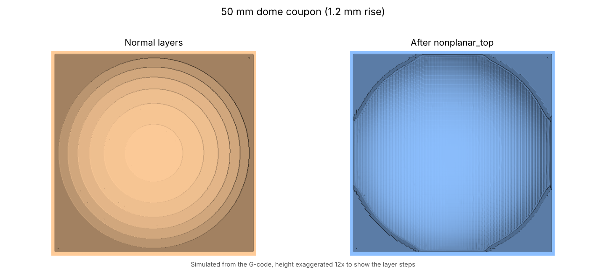

# nonplanar_top

**Smooth, layer-line-free top surfaces for gently curved prints on the Prusa Core One with the INDX toolhead.**

`nonplanar_top` is a PrusaSlicer post-processing script. It finds the shallow sloped or domed top surfaces in your sliced file and replaces their stair-stepped top layers with a skin that follows the curve: the nozzle moves up and down while it prints.



> **Status: beta (0.2.0).** Every converted file is re-simulated and must pass toolhead clearance, coverage and retraction checks before it is written, but the tool has not yet had wide real-world print testing. Print the [test coupons](docs/test-coupons.md) first and watch the end of the print, where the skin goes on.

## What it does

1. Reads the G-code PrusaSlicer just exported (plain `.gcode` or binary `.bgcode`).
2. Rebuilds the smooth surface from the layer steps.
3. Picks the areas that are shallow enough and where the nozzle, heater block, INDX toolhead body and part-cooling shroud all stay clear of the print.
4. Removes the stair-stepped top layers there and adds two passes that follow the surface:
   - a **levelling pass** of varying thickness that fills the steps
   - a **finish pass**, 0.2 mm thick, that follows the smooth surface
5. Simulates the whole converted file again. If any check fails, nothing is converted and PrusaSlicer tells you why.

Steep areas, chamfers, walls, flat tops and everything below the top keep normal layers.

## Quick start (Windows)

1. Install [Python 3.10+](https://www.python.org/downloads/) and tick **Add python.exe to PATH**.
2. Download the latest zip from [Releases](https://github.com/discojon/nonplanar-top/releases) and run **`install_windows.bat`**. It installs the libraries, copies the script to `C:\PrusaTools\nonplanar\` and puts the line for PrusaSlicer on your clipboard.
3. **Measure your fan shroud height** and put it in `nonplanar_top.ini` ([how](docs/measuring.md)).
4. In PrusaSlicer (Expert mode): **Print Settings > Output options > Post-processing scripts**, paste the line.
5. In **Print Settings > Notes**, type `nonplanar` and save the print profile under a new name. The script only acts on profiles whose notes contain that word.
6. Slice and export as usual. To see the result, open the exported file in **File > G-code preview**.

Full instructions: [docs/installation.md](docs/installation.md).

## Documentation

| Page | |
|---|---|
| [Installation](docs/installation.md) | Windows setup, PrusaSlicer profile, macOS/Linux notes |
| [Measuring your toolhead](docs/measuring.md) | The one measurement that matters |
| [Settings](docs/settings.md) | Every option in `nonplanar_top.ini` |
| [How it works](docs/how-it-works.md) | Surface reconstruction, skin passes, clipping |
| [Safety checks](docs/safety-checks.md) | What is simulated before a file is written |
| [Limitations](docs/limitations.md) | What it will not do |
| [Troubleshooting & FAQ](docs/troubleshooting.md) | Messages and what they mean |
| [Toolhead model](docs/toolhead-model.md) | Where the clearance numbers come from |
| [Test coupons](docs/test-coupons.md) | Sample parts to try first |

## Requirements

- Prusa Core One with the INDX toolhead (the clearance model is built for it)
- PrusaSlicer 2.7 or newer, relative extrusion (the Prusa default)
- Python 3.9+ with `numpy`, `scipy`, `shapely`, `opencv-python`

## Command line

```
py nonplanar_top.py  myprint.bgcode                  # writes myprint_nonplanar.gcode
py nonplanar_top.py  myprint.gcode -o out.gcode --force
py nonplanar_top.py  myprint.gcode --force --set shroud_height_mm=2.5 --set debug_image=1
```

`--force` converts even when the profile notes do not contain `nonplanar`.

## Feedback

Found a problem or have a print to share? Open an [issue](https://github.com/discojon/nonplanar-top/issues) and attach `nonplanar_top_last.log`.

## Licence and credits

AGPL-3.0-or-later, see [LICENSE](LICENSE). The toolhead clearance tables are licensed separately under [CC BY-SA 4.0](https://creativecommons.org/licenses/by-sa/4.0/): they are measured from the reverse-engineered [INDX CAD](https://github.com/robertsamples/INDX-CAD) by robertsamples, based on Prusa Research's INDX toolhead model, and from Prusa's `CORE_One_INDX_fan_shroud_r1` part. The `.bgcode` reader follows Prusa's [libbgcode](https://github.com/prusa3d/libbgcode) (AGPL-3.0) and ports its MeatPack decoder. Full list with links: [CREDITS.md](CREDITS.md).

Not affiliated with Prusa Research.
