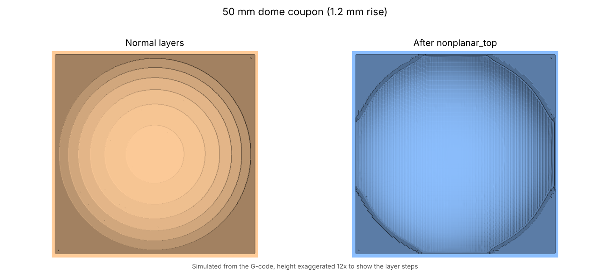
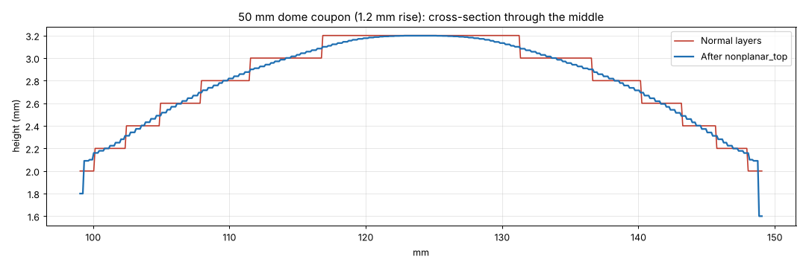
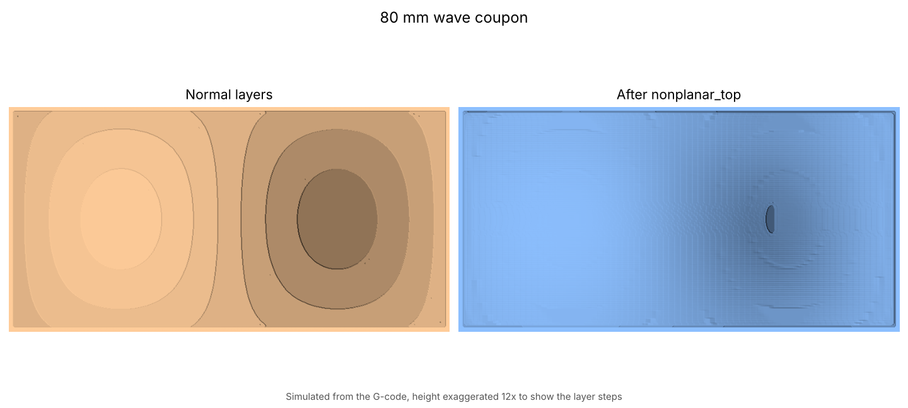
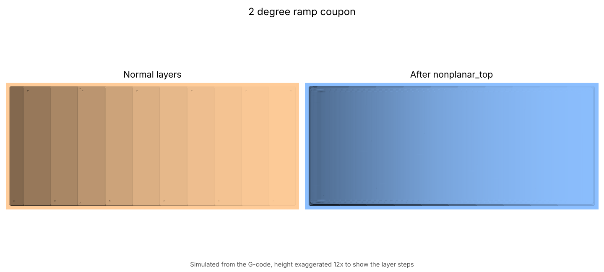

# Test coupons

Print times are PrusaSlicer estimates with the Core One INDX 0.20 mm profile; the skin time is a rough estimate.

Three small parts in `samples/` for trying the tool before using it on real prints. All three convert at the default settings.

| File | Size | Surface | Print time (normal) | Skin adds |
|---|---|---|---|---|
| `coupon_dome_50mm.stl` | 50 × 50 × 3.2 mm | spherical dome, 1.2 mm rise, up to 7° | 13 min | ~4 min |
| `coupon_ramp_2deg.stl` | 60 × 25 × 4.1 mm | flat 2° ramp | 8 min | ~2 min |
| `coupon_wave_80mm.stl` | 80 × 40 × 3.6 mm | gentle wave, ±0.6 mm | 16 min | ~4 min |

Print each once with your normal profile and once with the nonplanar profile, then compare under a raking light.

## What to look for
- **Skin adhesion:** the finish pass should be continuous with no gaps or lifted lines.
- **Edges:** where the skin meets vertical walls, a clean edge; no ridge.
- **Flow:** if the finish pass looks starved or over-full, adjust your filament's extrusion multiplier (the skin uses it).
- **Clearance:** the shroud must never touch the part. If it does, stop the print and lower `shroud_height_mm`.

## Simulated results

Example log and region map from the dome coupon: `samples/example_output/`.
