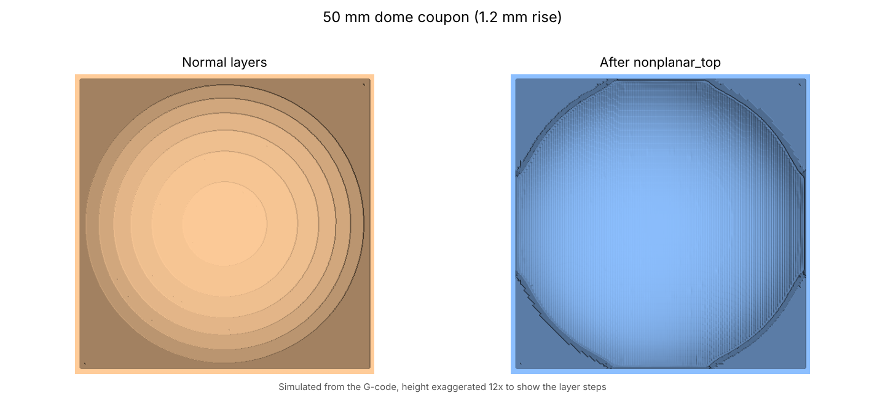
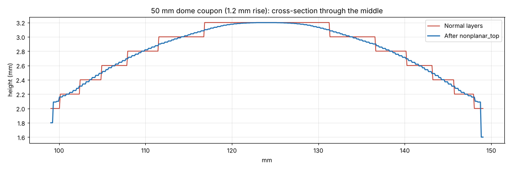
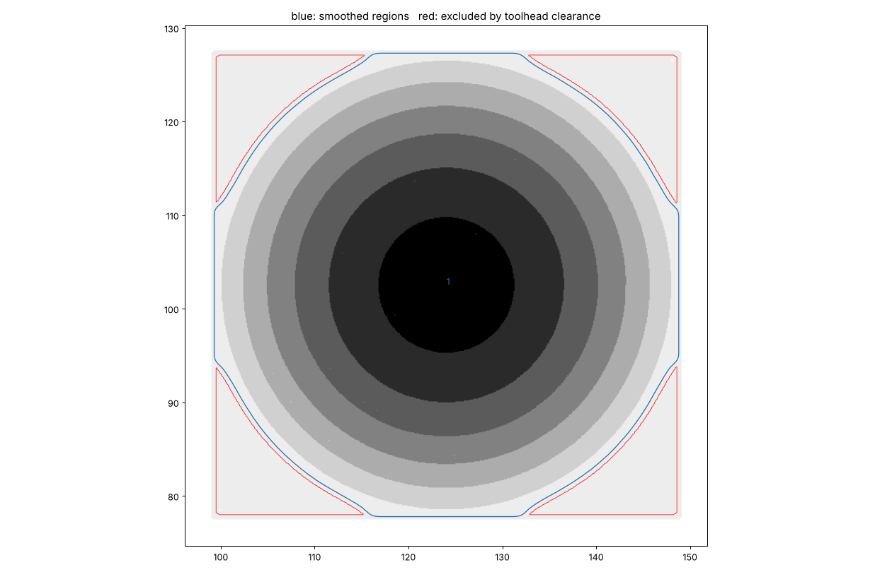

<!-- Printables article. Title and summary first, then the body. -->

# Title
Smooth tops without ironing: nonplanar top surfaces on the Core One INDX

# Summary
How a PrusaSlicer post-processing script turns the stair-stepped top of a gently curved print into a smooth skin, and how it keeps the INDX toolhead and fan shroud clear of the part.

---

# Body

## The problem: contour lines on curved tops

Slice a gently domed or sloped part and the top comes out as a staircase. Each layer stops a little short of the one below, and on a shallow curve those steps are millimetres wide, so you get clear contour lines across the surface. Thinner layers make the steps smaller but never remove them, and ironing only flattens each step; it can't remove the staircase.

The fix is to print the top surface **nonplanar**: let the nozzle move up and down while it extrudes, so the last layers follow the curve instead of stepping.

## What nonplanar_top does

`nonplanar_top` is a PrusaSlicer post-processing script for the **Prusa Core One with the INDX toolhead**. You slice as usual; on export, PrusaSlicer hands the G-code to the script, which:

1. **Maps the print from above** on a 0.1 mm grid, from every extrusion in the file.
2. **Rebuilds the smooth surface from the layer steps.** The edge of each step is a contour line of the real model (the slicer cuts each layer at its mid-height), so interpolating between neighbouring contours recovers the surface. On the test coupons this lands within about ±0.05 mm of the true shape, against ±0.1 mm for the steps.
3. **Picks regions** that are top surfaces, shallow enough, cross several layer steps, and where the whole toolhead stays clear.
4. **Removes the stair-stepped top layers** in those regions (original retractions are kept, extra ones are added around the removed stretches).
5. **Prints a two-pass skin at the end of the print:** a *levelling pass* of varying thickness that fills the steps, then a 0.2 mm *finish pass* that follows the surface, at 90° to the first.
6. **Simulates the converted file again** before writing it. Toolhead clearance, coverage, retractions and feed rates all have to pass, or nothing is converted and PrusaSlicer shows why.

## The hard part: not hitting the part

When the nozzle prints the low edge of a dome, everything else on the toolhead passes over the higher middle. On the INDX that means:

- the nozzle itself (about a 1.2 mm flat with a ~47° cone),
- the heater sock, about 2.7 mm above the tip,
- the tool body and INDX housing, only about 4 mm above the tip out to roughly 46 mm away,
- and the **part-cooling fan shroud**, a ring roughly 18–28 mm from the nozzle whose height depends on your printer.

The script models the head as its lowest point at each distance from the nozzle, in any direction, from the reverse-engineered INDX CAD and Prusa's shroud model. For every point it works out how low the nozzle may go without any part of the head coming within a safety margin (0.3 mm by default) of the print, including other objects on the plate. Anything that would come closer keeps normal layers.

That's why **measuring your shroud** matters: it's the one number that varies between printers. Heat the nozzle, measure the gap from the nozzle tip to the lowest point of the shroud, and put it in the settings file. The default, 1.5 mm, is deliberately cautious.

## Trying it

The model page has three test coupons and a ready PrusaSlicer project:

| Coupon | Surface |
|---|---|
| Dome, 50 mm | 1.2 mm rise, up to 7° |
| Ramp | flat 2° slope |
| Wave, 80 mm | ±0.6 mm |

1. Install Python and run `install_windows.bat` from the download.
2. Measure your shroud height and enter it in `nonplanar_top.ini`.
3. Open `nonplanar_top_test_coupons.3mf`. It uses Prusa's stock Core One INDX profiles with a **0.20mm NONPLANAR** print profile, which is the stock 0.20mm Balanced with `nonplanar` in Notes, 5 top layers and no ironing.
4. Add the post-processing line from the installer to the print profile, slice, and export.
5. Open the exported file with *File > G-code preview* to see the skin; the normal preview shows the file before conversion.

Print one coupon with your normal profile and one with the nonplanar profile and compare them under a raking light. Watch the end of the print, where the skin goes on.

## Limits

- Shallow surfaces only: 12° by default, and the shroud limits how much a surface can rise within about 30 mm.
- Tall parts within about 45 mm block smoothing.
- The top has to be printed with the last tool used.
- No sequential printing or spiral vase.
- It's a **beta**: everything is checked in simulation, but it needs more real-world prints. Reports and photos are very welcome.

## Source and credits

Code, documentation and updates: **https://github.com/discojon/nonplanar-top** (AGPL-3.0; toolhead data tables CC BY-SA 4.0).

- INDX toolhead geometry from the reverse-engineered **INDX CAD by robertsamples** (CC BY-SA 4.0), based on **Prusa Research's INDX toolhead model**.
- Fan shroud shape from **Prusa Research's CORE_One_INDX_fan_shroud_r1**.
- Binary G-code reading based on **Prusa Research's libbgcode** (AGPL-3.0), including its **MeatPack** decoder (MeatPack by **Scott Mudge**); compression format **heatshrink** by **Scott Vokes / Atomic Object**.

Not affiliated with Prusa Research.
